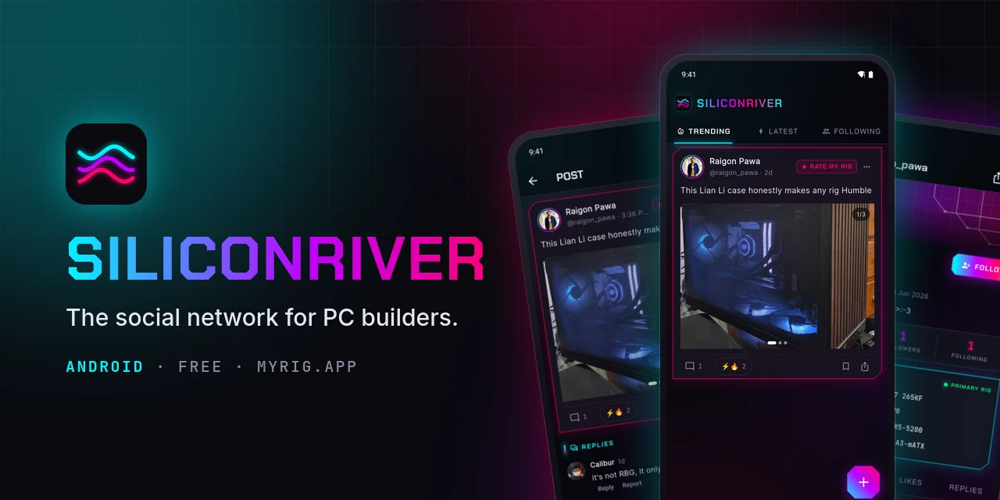
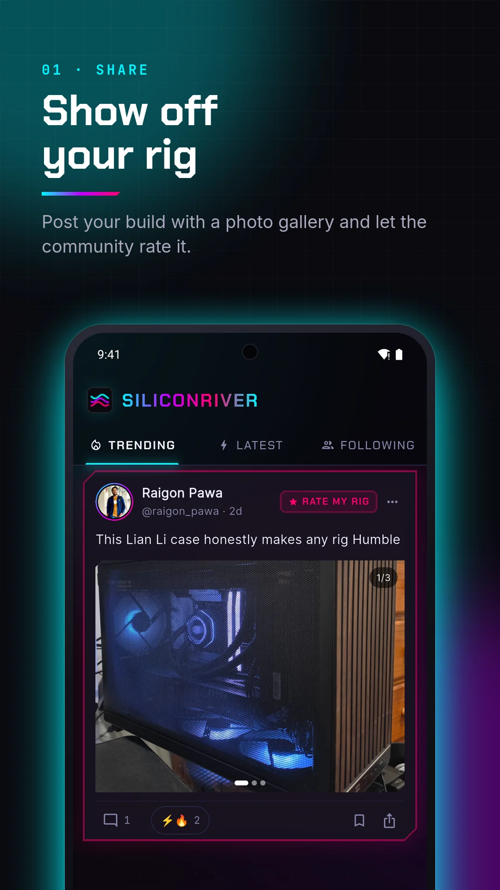
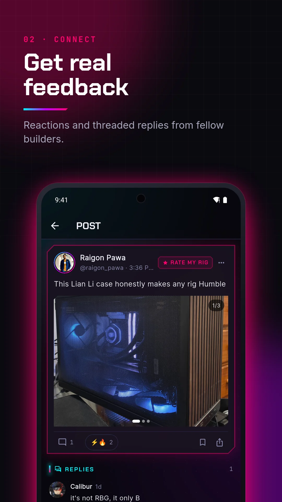
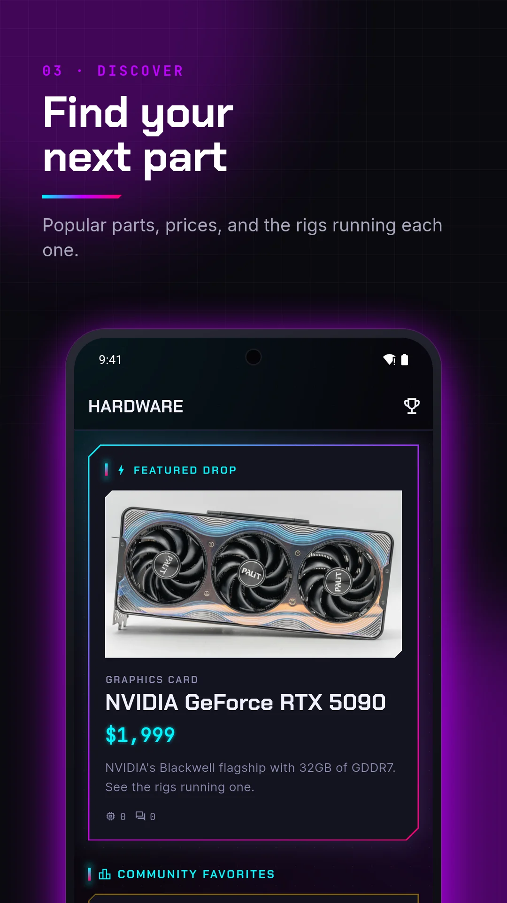
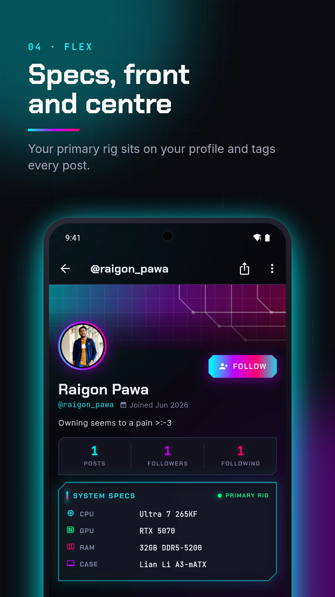
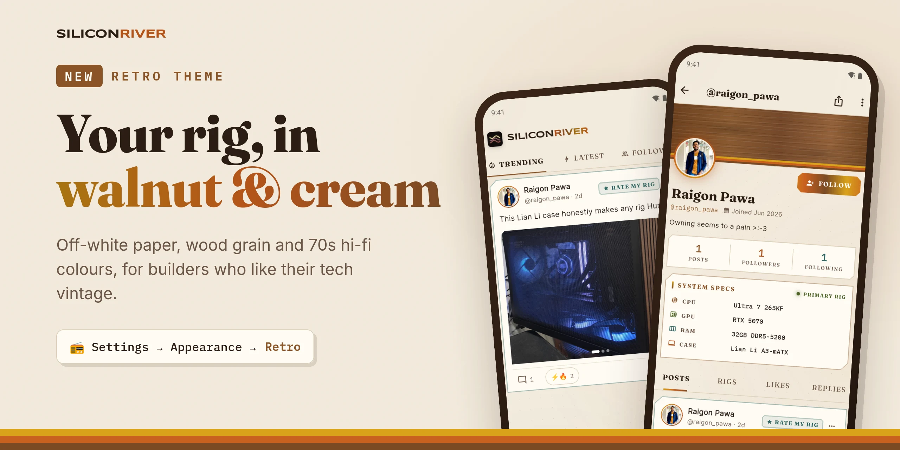

<div align="center">



Show off your rig, rate other people's builds, and climb the leaderboards.

[](https://github.com/raigon-pawa/siliconriver-release/releases)
[](https://github.com/raigon-pawa/siliconriver-release/releases)

[](LICENSE)

### [⬇ Download the APK](https://github.com/raigon-pawa/siliconriver-release/releases/download/v1.3.0-beta.4/siliconriver-1.3.0-beta.4.apk)

<sub>1.3.0 beta 4 · [All releases](https://github.com/raigon-pawa/siliconriver-release/releases) · or use it in your browser at [myrig.app](https://myrig.app)</sub>

<br>






<br><br>



</div>

## Features

- **Your rigs:** desktops and laptops. List your parts in the spec sheet (search the dropdowns or type your own) and your primary rig shows on your profile and tags your posts.
- **Feed:** Trending, Latest and Following, with photo galleries, benchmark posts, questions and Rate My Rig.
- **Reactions and comments:** five community reactions (✨ ⚡ 🔌 🔥 👑) and threaded replies.
- **Explore:** search builders, parts and posts, and see what's trending.
- **Hardware:** a catalog of popular parts, with the rigs and posts that use each one.
- **Benchmarks:** log Cinebench, 3DMark and Geekbench scores and compete on the leaderboards, with separate rankings for desktops and laptops.
- **Notifications:** push alerts for reactions, comments, replies, follows and @mentions.
- **Saved posts, editing and pinning:** bookmark posts, fix typos, pin your best post to your profile.
- **Dark, light and retro themes** (📻 retro: off-white paper and walnut wood), and sign-in with Google or email.

## Install

1. On your Android phone, tap **[Download the APK](https://github.com/raigon-pawa/siliconriver-release/releases/download/v1.3.0-beta.4/siliconriver-1.3.0-beta.4.apk)**.
2. Open the downloaded file.
3. If Android asks, allow your browser or Files app to **install unknown apps**, then tap **Install**.

**Requirements:** Android 7.0 or newer.

### Updates

- **New versions come to you.** From 1.3.0 beta 4, the app tells you when a new version is out: tap **Update** and it downloads and installs it. Check any time in Profile → Settings → Version. The first time, Android asks you to allow installs from SiliconRiver.
- **Small fixes arrive silently** in the background and apply the next time you open the app. Settings shows the current patch, e.g. `1.3.0-beta.4 (patch 1)`.
- On beta 3 or older? Download beta 4 above once and install it over your current app; you stay signed in.
- If an older test build won't update ("App not installed"), uninstall it first.

## Releases

Builds marked **Pre-release** are betas: newest features first, so expect the odd bug.

| Version | Highlights |
|---|---|
| [**1.3.0 beta 4**](https://github.com/raigon-pawa/siliconriver-release/releases/tag/v1.3.0-beta.4) | In-app updates, searchable part lists in the rig form, follower lists. **Since then:** laptop rigs with their own leaderboards, and the new retro theme |
| [1.2.0 beta 3](https://github.com/raigon-pawa/siliconriver-release/releases/tag/v1.2.0-beta.3) | Push notifications, saved posts, @mentions, edit and pin posts |
| [1.2.0 beta 2](https://github.com/raigon-pawa/siliconriver-release/releases/tag/v1.2.0-beta.2) | Automatic small updates |
| [1.2.0 beta 1](https://github.com/raigon-pawa/siliconriver-release/releases/tag/v1.2.0-beta.1) | First public beta, native Google sign-in |

## FAQ

<details>
<summary><b>Why isn't it on the Play Store?</b></summary>

It will be. Until then, betas are published here first.
</details>

<details>
<summary><b>Is it safe to install an APK?</b></summary>

Only install APKs from this page. Every release is signed with the same key, which is why new versions install over old ones, and each release lists the file's SHA-256 so you can check it (see below).
</details>

<details>
<summary><b>Is there an iPhone app?</b></summary>

Not yet. On iPhone, use [myrig.app](https://myrig.app) in Safari. It's the same account and content.
</details>

<details>
<summary><b>Is my account the same as on the website?</b></summary>

Yes. Sign in with the same Google account or email and everything is there: posts, rigs, followers and notifications.
</details>

<details>
<summary><b>Check the download (optional)</b></summary>

Compare the APK's SHA-256 with the one in the release notes:

```sh
sha256sum siliconriver-*.apk                            # Linux
shasum -a 256 siliconriver-*.apk                        # macOS
certutil -hashfile siliconriver-<version>.apk SHA256    # Windows
```
</details>

## Feedback

Found a bug or have an idea? [Open an issue](https://github.com/raigon-pawa/siliconriver-release/issues/new/choose). For bugs, include your phone model, Android version and the app version (Profile → Settings).

## License

[MIT](LICENSE)
