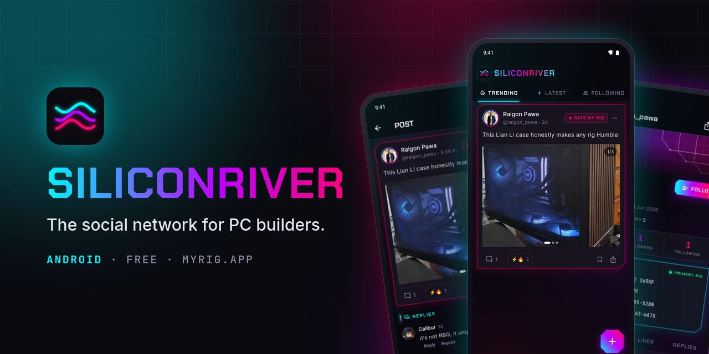
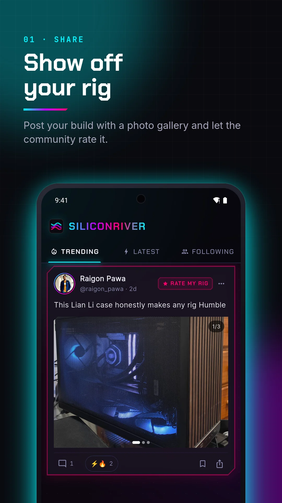
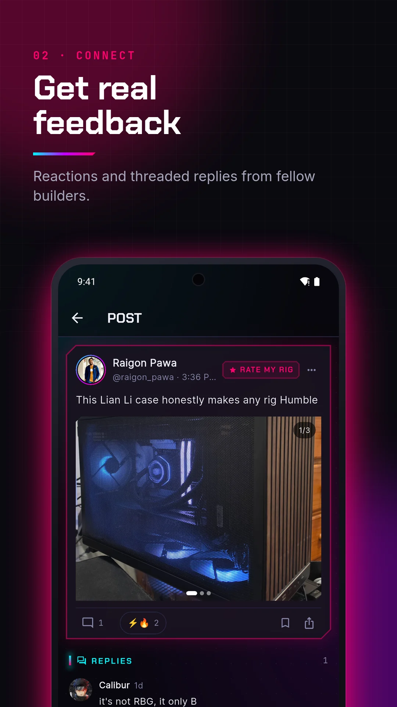
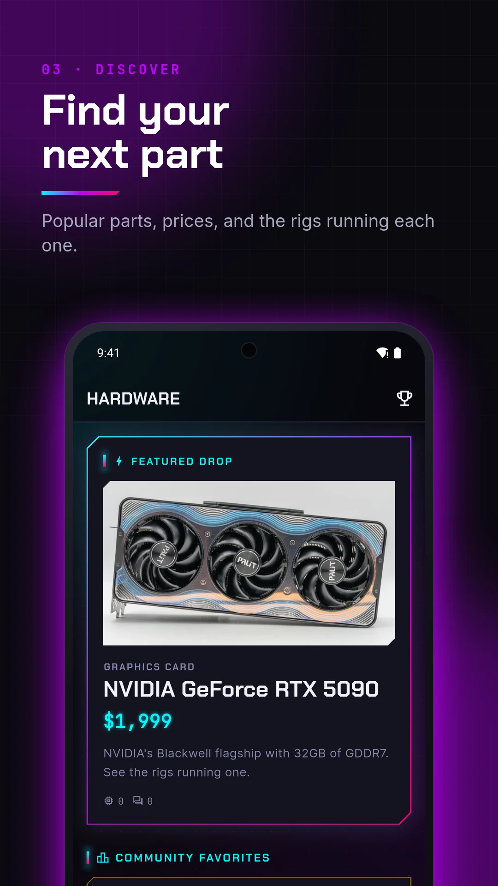
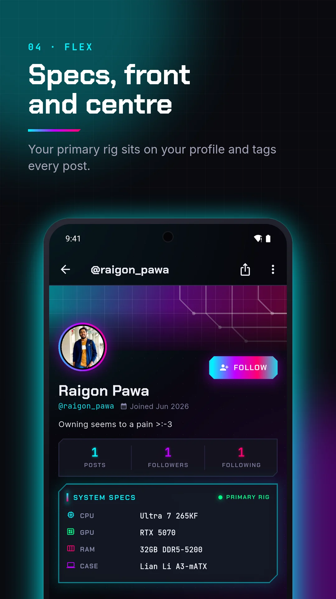
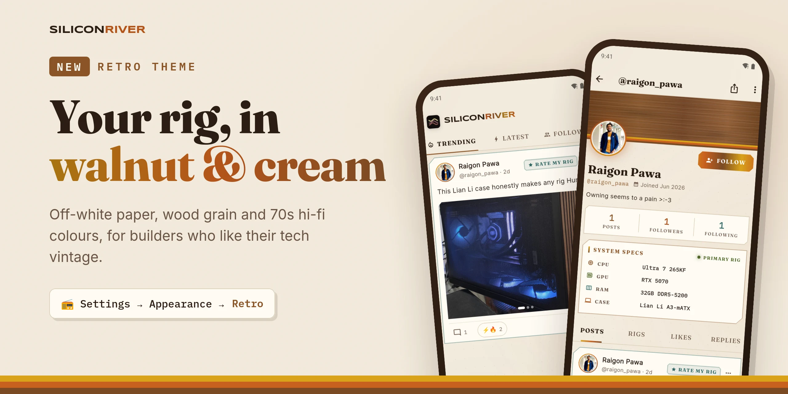
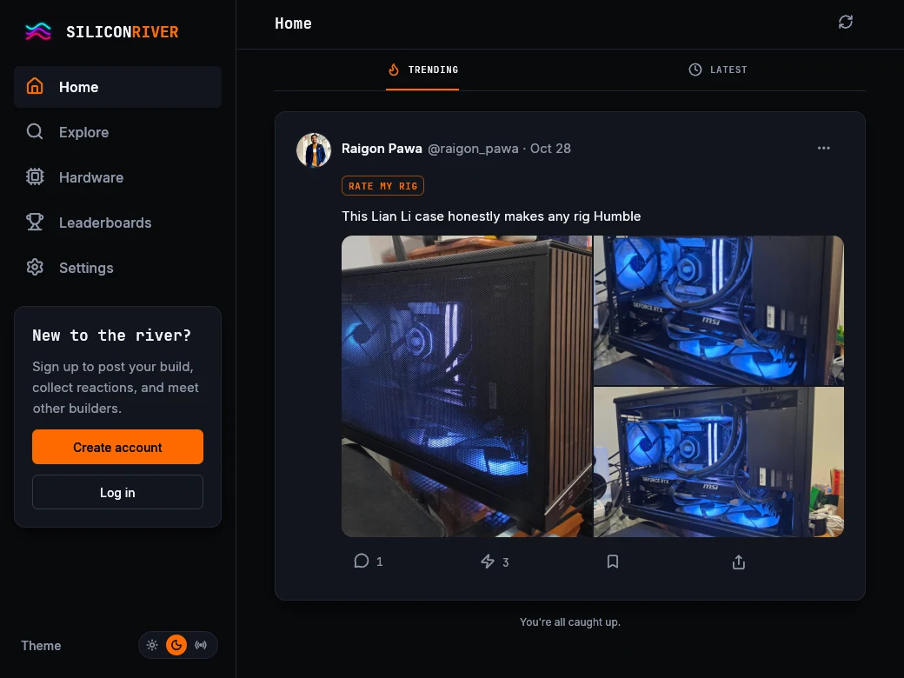

<div align="center">



Show off your rig, rate other people's builds, and climb the leaderboards.

[](https://github.com/raigon-pawa/siliconriver-release/releases)
[](https://github.com/raigon-pawa/siliconriver-release/releases)

[](LICENSE)

### [⬇ Download the APK](https://github.com/raigon-pawa/siliconriver-release/releases/download/v1.6.0-beta.9/siliconriver-1.6.0-beta.9.apk)

<sub>1.6.0 beta 9 · [All releases](https://github.com/raigon-pawa/siliconriver-release/releases) · or use it in your browser at [myrig.app](https://myrig.app)</sub>

<sub><b>New:</b> [the PC app for Windows and Linux](#siliconriver-for-pc)</sub>

<br>






<br><br>



</div>

## Features

- **Your rigs:** desktops and laptops. List your parts in the spec sheet (search the dropdowns or type your own) and your primary rig shows on your profile and tags your posts.
- **Feed:** Trending, Latest and Following, with photo galleries, benchmark posts, questions and Rate My Rig.
- **Reactions and comments:** five community reactions (✨ ⚡ 🔌 🔥 👑) and threaded replies.
- **Explore:** search builders, parts and posts, and see what's trending.
- **Hardware:** a catalog of popular parts, with the rigs and posts that use each one.
- **Benchmarks:** log Cinebench, 3DMark and Geekbench scores and compete on the leaderboards, with separate rankings for desktops and laptops.
- **Notifications:** push alerts for reactions, comments, replies, follows and @mentions.
- **Saved posts, editing and pinning:** bookmark posts, fix typos, pin your best post to your profile.
- **Dark, light and retro themes** (📻 retro: off-white paper and walnut wood), and sign-in with Google or email.

## Install on Android

1. On your Android phone, tap **[Download the APK](https://github.com/raigon-pawa/siliconriver-release/releases/download/v1.6.0-beta.9/siliconriver-1.6.0-beta.9.apk)**.
2. Open the downloaded file.
3. If Android asks, allow your browser or Files app to **install unknown apps**, then tap **Install**.

**Requirements:** Android 8.0 or newer.

### Updates

- **New versions come to you.** From 1.3.0 beta 4, the app tells you when a new version is out: tap **Update** and it downloads and installs it. Check any time in Profile → Settings → Version. The first time, Android asks you to allow installs from SiliconRiver.
- **Small fixes arrive silently** in the background and apply the next time you open the app. Settings shows the current patch, e.g. `1.6.0-beta.9 (patch 1)`.
- On beta 3 or older? Download the latest beta above once and install it over your current app; you stay signed in.
- If an older test build won't update ("App not installed"), uninstall it first.

## SiliconRiver for PC

A native app for Windows and Linux. Same account, same feed, in its own window.

<div align="center">



### [⬇ Windows](https://github.com/raigon-pawa/siliconriver-release/releases/download/desktop-v0.5.0/siliconriver-windows-x86_64.exe) · [⬇ Linux](https://github.com/raigon-pawa/siliconriver-release/releases/download/desktop-v0.5.0/siliconriver-linux-x86_64)

<sub>0.5.0 beta · 64-bit · Windows 10 or newer · Linux: Ubuntu 22.04, Debian 12 or newer (glibc 2.35+)</sub>

</div>

- **What's in it:** the Trending, Latest and Following feeds, posts with reactions and threaded replies, Explore, the Hardware catalog, leaderboards, notifications and profiles, plus a Performance page with live readings from your own PC, which you can also watch from the Android app.
- **Light, dark and retro themes**, and sign-in with Google or email.
- **Not here yet:** photo uploads, polls, and editing your rigs and profile. Those open the website for now.

### Install on Windows

1. Download **[siliconriver-windows-x86_64.exe](https://github.com/raigon-pawa/siliconriver-release/releases/download/desktop-v0.5.0/siliconriver-windows-x86_64.exe)**. It's the whole app in one file.
2. Double-click it. The app isn't code-signed yet, so Windows may show **"Windows protected your PC"**: click **More info**, then **Run anyway**.
3. In the app, open **Settings** and choose **Add to Start menu**. SiliconRiver now opens from the Start menu, and the downloaded file can be deleted.

### Install on Linux

Download **[siliconriver-linux-x86_64](https://github.com/raigon-pawa/siliconriver-release/releases/download/desktop-v0.5.0/siliconriver-linux-x86_64)**, then:

```sh
chmod +x siliconriver-linux-x86_64
./siliconriver-linux-x86_64 --install
```

SiliconRiver is now in your app launcher, with its icon, and the downloaded file can be deleted. It installs for your user only, into `~/.local`, so it needs no password and can update itself.

### Updates on PC

The app looks for a new version each time it starts, downloads it, checks it against the SHA-256 published here, and restarts into it. You can also check in Settings → About.

## Releases

Builds marked **Pre-release** are betas: newest features first, so expect the odd bug.

**PC (Windows and Linux)**

| Version | Highlights |
|---|---|
| [**0.5.0**](https://github.com/raigon-pawa/siliconriver-release/releases/tag/desktop-v0.5.0) | Show on my phone: a switch on the Performance page sends your live readings to your account so the Android app (1.6.0 beta 9 or newer) can show them. Off until you turn it on, and only you can see them |
| [**0.4.0**](https://github.com/raigon-pawa/siliconriver-release/releases/tag/desktop-v0.4.0) | Installs itself: "Add to Start menu" on Windows, "Add to app launcher" or `--install` on Linux, with its icon and no administrator password |
| [**0.3.0**](https://github.com/raigon-pawa/siliconriver-release/releases/tag/desktop-v0.3.0) | Performance page: live processor, NVIDIA graphics card and memory readings from your own PC, with a minute of history. Nothing is uploaded |
| [**0.2.0**](https://github.com/raigon-pawa/siliconriver-release/releases/tag/desktop-v0.2.0) | First PC release, for Windows and Linux: feeds, posts and replies, Explore, Hardware, leaderboards, three themes, updates itself |

**Android**

| Version | Highlights |
|---|---|
| [**1.6.0 beta 9**](https://github.com/raigon-pawa/siliconriver-release/releases/tag/v1.6.0-beta.9) | My PC, live: watch your computer's processor, graphics card and memory readings from Explore, sent by SiliconRiver for PC 0.5.0 or newer |
| [1.5.0 beta 8](https://github.com/raigon-pawa/siliconriver-release/releases/tag/v1.5.0-beta.8) | New copper look in dark and light, builder stats on your profile, two-factor setup in Settings, alerts that refresh on their own, crash fix |
| [1.4.1 beta 7](https://github.com/raigon-pawa/siliconriver-release/releases/tag/v1.4.1-beta.7) | Under-the-hood upgrades: steadier sharing and crash reporting. Needs Android 8.0 or newer |
| [1.4.0 beta 6](https://github.com/raigon-pawa/siliconriver-release/releases/tag/v1.4.0-beta.6) | Two-factor sign-in, myrig.app links open in the app, share photos into the app, rig pages, pure black theme, works offline, polls and quote posts |
| [1.3.0 beta 5](https://github.com/raigon-pawa/siliconriver-release/releases/tag/v1.3.0-beta.5) | Fewer profile loading errors, easier-to-read light theme, bigger tap targets, logos that match the website |
| [1.3.0 beta 4](https://github.com/raigon-pawa/siliconriver-release/releases/tag/v1.3.0-beta.4) | In-app updates, searchable part lists in the rig form, follower lists. **Since then:** laptop rigs with their own leaderboards, and the new retro theme |
| [1.2.0 beta 3](https://github.com/raigon-pawa/siliconriver-release/releases/tag/v1.2.0-beta.3) | Push notifications, saved posts, @mentions, edit and pin posts |
| [1.2.0 beta 2](https://github.com/raigon-pawa/siliconriver-release/releases/tag/v1.2.0-beta.2) | Automatic small updates |
| [1.2.0 beta 1](https://github.com/raigon-pawa/siliconriver-release/releases/tag/v1.2.0-beta.1) | First public beta, native Google sign-in |

## Coming next

What we're working on. No dates; small updates arrive in the app as they're ready.

- **Google Play release**, so you can install and update through the Play Store.
- **More hardware pages, with photos**, for the parts the community runs.
- **Faster loading**, on the website and in the app.

Got an idea? [Suggest a feature](https://github.com/raigon-pawa/siliconriver-release/issues/new/choose).

## FAQ

<details>
<summary><b>Why isn't it on the Play Store?</b></summary>

It will be. Until then, betas are published here first.
</details>

<details>
<summary><b>Is it safe to install an APK?</b></summary>

Only install APKs from this page. Every release is signed with the same key, which is why new versions install over old ones, and each release lists the file's SHA-256 so you can check it (see below).
</details>

<details>
<summary><b>Is there an iPhone app?</b></summary>

Not yet. On iPhone, use [myrig.app](https://myrig.app) in Safari. It's the same account and content.
</details>

<details>
<summary><b>Is my account the same as on the website?</b></summary>

Yes. Sign in with the same Google account or email and everything is there: posts, rigs, followers and notifications.
</details>

<details>
<summary><b>Check the download (optional)</b></summary>

Compare the file's SHA-256 with the one in the release notes (works for the APK and the PC downloads):

```sh
sha256sum siliconriver-*                                # Linux
shasum -a 256 siliconriver-*                            # macOS
certutil -hashfile <downloaded file> SHA256             # Windows
```
</details>

## Feedback

Found a bug or have an idea? [Open an issue](https://github.com/raigon-pawa/siliconriver-release/issues/new/choose). For bugs, include your phone model, Android version and the app version (Profile → Settings). For the PC app, include your operating system and the version from Settings → About.

## License

[MIT](LICENSE)
